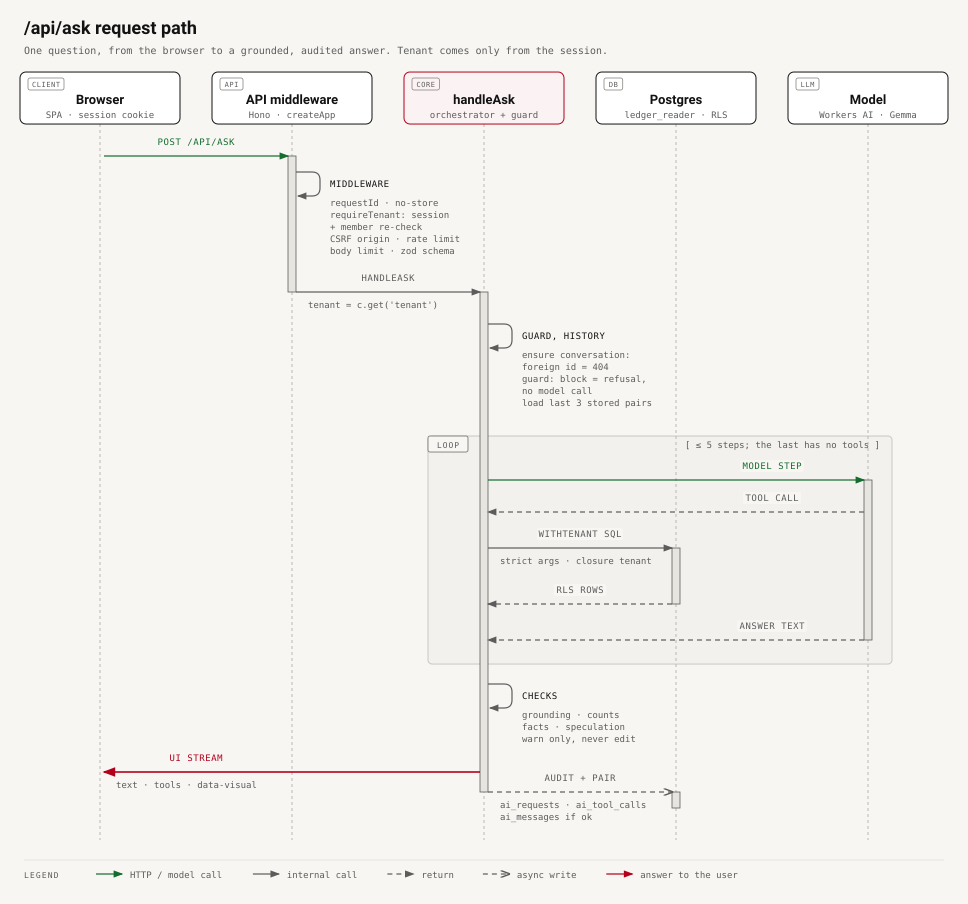
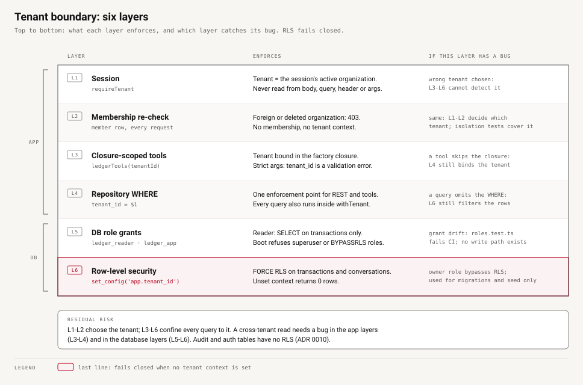
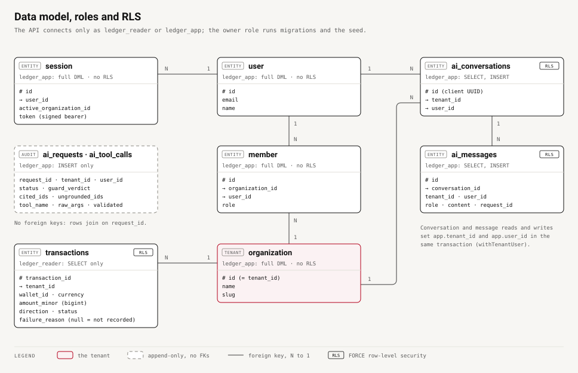

# DemoLedger

A multi-tenant ledger transaction assistant. A finance-operations user asks natural-language questions about wallet transactions, for example "Why did wallet WALLET-A-001 have failed transactions?". An LLM answers by calling two **read-only, tenant-scoped backend tools** through native function calling, and the answer cites transaction IDs taken from those tool results.

- **Backend:** Node 24 + TypeScript, Hono, Better Auth (organization = tenant), PostgreSQL 17, Drizzle.
- **AI:** AI SDK v7 against Cloudflare Workers AI (Free plan, OpenAI-compatible endpoint), with a prompt-injection guard (heuristic, or Clef-flash).
- **Web:** Vite + React 19 SPA with a streaming chat and a transactions table.
- **Isolation:** enforced in backend queries and database roles, never by the prompt.

All data is synthetic: 100 fictional transactions across two fictional tenants.

## Prerequisites

Works on macOS and Linux; on Windows, use WSL2.

| Tool | Version | Install | Check |
|---|---|---|---|
| Node.js | **24** (pinned in `.nvmrc`) | `nvm install && nvm use` in the repo, or `brew install node@24` | `node -v` → `v24.x` |
| pnpm | **10** | `corepack enable` (ships with Node), or `npm i -g pnpm@10` | `pnpm -v` → `10.x` |
| Docker | Docker Desktop, OrbStack or Docker Engine with Compose v2, **running** | docker.com or orbstack.dev | `docker compose version` and `docker info` both succeed |
| git, openssl | any recent | preinstalled on macOS and most Linux distributions | `git --version`, `openssl version` |

- Free host ports: **5433** (Postgres, bound to 127.0.0.1 only), **3001** (API) and **5173** (web).
- **Cloudflare credentials are optional:** the repo owner provides them separately (see [Setup](#setup)). Without them, everything except live AI answers works, including every test.
- No other services, accounts or paid APIs are needed. The database runs in Docker, and the 100 fictional transactions are seeded by `pnpm db:reset`; a readable copy is committed at [`packages/db/seed-data/transactions.csv`](packages/db/seed-data/transactions.csv).

## Setup

```bash
pnpm install
cp .env.example .env
```

> **Cloudflare credentials.** For convenience, the repo owner will provide the Cloudflare credentials, `CF_ACCOUNT_ID` and `CF_API_TOKEN`, separately. Put them in `.env` as `CF_ACCOUNT_ID=…` and `CF_API_TOKEN=…` (both lines already exist there, empty), and never commit them. Everything except the live AI features works without them: the transactions screen, the REST API and every test run as normal, the guard falls back to the local heuristic, and the assistant replies "The AI provider is not configured on this server" (`llm_unconfigured`, still audited). If you add them later, restart `pnpm dev`.

```bash
# set a real secret (the API refuses the placeholder):
sed -i.bak "s|^BETTER_AUTH_SECRET=.*|BETTER_AUTH_SECRET=$(openssl rand -base64 32)|" .env && rm .env.bak
pnpm db:up        # postgres:17 on 127.0.0.1:5433 (loopback only), creates demoledger + demoledger_test
pnpm db:reset     # drop schema, migrate, create roles, seed 100 transactions (anchored to today, UTC)
pnpm dev          # API on http://localhost:3001, web on http://localhost:5173
```

Open http://localhost:5173 and use **Sign in as Alpha ops** or **Sign in as Beta ops**. The **Transactions** screen has filters for wallet, status, direction and period, and pages through 10 rows at a time. The **Assistant** screen is the chat.

With the credentials in `.env`, the assistant answers live and the guard uses Clef-flash plus the heuristic.

Seed dates move with the run date (ADR 0005). If the dev database was seeded on an earlier day, re-run `pnpm db:reset` so that "yesterday" and "this week" have data.

## Test credentials (fictional, test-only)

| Organization | Tenant ID | Email | Password |
|---|---|---|---|
| Alpha Payments (fictional) | `tenant_alpha` | `ops.alpha@demoledger.test` | `AlphaLedger#2026` |
| Beta Wallets (fictional) | `tenant_beta` | `ops.beta@demoledger.test` | `BetaLedger#2026` |

Alpha has wallets `WALLET-A-001` (EUR), `-002` (EUR), `-003` (USD) and `-004` (GBP). Beta has `WALLET-B-001` (EUR), `-002` (EUR) and `-003` (USD). Self-service sign-up is disabled.

## Example prompts

The assistant's empty state offers these five. The first four are the assignment's examples, verbatim; the fifth demonstrates a visual answer:

1. Why did wallet WALLET-A-001 have failed transactions?
2. Show the largest completed outgoing transactions this week.
3. How many failed transactions occurred yesterday?
4. Summarize recent activity for WALLET-A-002.
5. Show me a graph of outgoing transactions for the past week.

More to try:
- "How many completed transactions does WALLET-A-003 have in the last 30 days?"
- "Total completed outgoing amount by wallet this week."
- To see the guard block a write request: "Refund TXN-A-0001".

All periods are **UTC**, and weeks start on Monday.

**Visual answers (charts, tables, stats).**
- **Try it:** "Show me a graph of outgoing transactions for the past week." or "Show me a chart of failed transactions in the past month by cause." (aggregates support `group_by: failure_reason`; a missing reason is counted as "Not recorded").
- **Progress:** each step shows as it runs ("Searching transactions…", then "Analysing the results…") until the answer streams, so a multi-step answer never looks stalled. If the stream drops or the server is unreachable, the answer shows an error with **Try again**.
- **How it works:**
  - The assistant first looks the data up with a normal tool call.
  - It then calls `present_visual` to choose a bar chart, line chart, table or stat.
  - The server builds the visual from that SQL result: one series per currency, amounts formatted on the server.
  - The model never types the numbers (ADR 0009).

**Follow-ups and conversations.**
- **Follow-ups work within a conversation.** For example, after "Show the largest completed outgoing transactions this week." you can ask "Which wallets did these transactions use?". The server replays the last 3 answered question/answer pairs that it stored itself (ADR 0008); the browser's copy of the chat is never trusted.
- **New conversation** starts a fresh thread (new conversation ID, empty history). It is in the assistant header (top right; disabled while the thread is empty) and in the command menu, opened with ⌘K / Ctrl+K (there is no header ⌘ button).

## Configuration

Every variable lives in `.env.example`, with comments. The API validates them at boot (`apps/api/src/lib/config.ts`).

| Variable | Default / example | Purpose |
|---|---|---|
| `POSTGRES_USER` / `POSTGRES_PASSWORD` | `demoledger_owner` / dev placeholder | Owner role created by the Postgres image. Used only by migrations, `roles.sql` and the seed. |
| `LEDGER_READER_PASSWORD` | dev placeholder | Password for `ledger_reader` (SELECT on `transactions` only). |
| `LEDGER_APP_PASSWORD` | dev placeholder | Password for `ledger_app` (Better Auth tables + INSERT-only audit). |
| `DATABASE_URL` | `postgres://demoledger_owner:…@localhost:5433/demoledger` | Owner connection for `db:migrate` / `db:seed` / `db:reset`. |
| `DATABASE_URL_READER` | `postgres://ledger_reader:…@localhost:5433/demoledger` | API pool for the repository and AI tools. |
| `DATABASE_URL_APP` | `postgres://ledger_app:…@localhost:5433/demoledger` | API pool for auth and audit writes. |
| `TEST_DATABASE_URL`, `TEST_DATABASE_URL_READER`, `TEST_DATABASE_URL_APP` | same, on `demoledger_test` | Tests map these onto `DATABASE_URL*` (`vitest.shared.ts`), with compose defaults if unset. |
| `DB_STATEMENT_TIMEOUT_MS` | `5000` | Postgres `statement_timeout` on both pools. This is also the effective tool timeout. |
| `API_PORT` | `3001` | API port (the Vite proxy targets 3001). |
| `LOG_LEVEL` | `info` | `trace` · `debug` · `info` · `warn` · `error`. |
| `BETTER_AUTH_SECRET` | none, **required** | 32+ random characters (`openssl rand -base64 32`). The `.env.example` placeholder is rejected. |
| `BETTER_AUTH_URL` | `http://localhost:3001` | Public base URL of the auth server. |
| `BETTER_AUTH_TRUSTED_ORIGINS` | `http://localhost:5173,http://localhost:3001` | Origins allowed for auth routes and for cookie-authenticated `POST /api/ask`. |
| `CF_ACCOUNT_ID` | empty | Cloudflare Account ID. Empty means no LLM (`llm_unconfigured`). |
| `CF_API_TOKEN` | empty | API token with **Workers AI: Read** only. |
| `LLM_MODEL` | `@cf/google/gemma-4-26b-a4b-it` | Chat model; it must support tool calling and be on the Free plan. Fallback: `@cf/openai/gpt-oss-120b` (faster tail, about 2.4x the Neurons, leaked markup in live use). History and evidence: ADR 0007. |
| `LLM_BASE_URL` | derived from `CF_ACCOUNT_ID` | Override for the OpenAI-compatible endpoint. |
| `LLM_REQUEST_TIMEOUT_MS` | `45000` (max 120000) | Whole `/api/ask` budget (`AbortSignal`), and the only wall-clock bound on a request. |
| `LLM_STEP_TIMEOUT_MS` | `15000` (max 60000) | Max wait for the first streamed chunk of each model step. It is idle-based: a step that keeps streaming is never cut off. |
| `LLM_REASONING_EFFORT` | `low` | `low` · `medium` · `high`, mapped per model family: gpt-oss → `reasoning_effort`, GLM → thinking (low = off). No effect on Gemma. |
| `LLM_MAX_OUTPUT_TOKENS` | `2048` (64–8192) | Output token cap per model step; reasoning tokens count too. A capped answer is audited `truncated`, and the UI warns that it was cut off. |
| `LLM_MAX_RETRIES` | `2` (max 5) | Retries on 429/5xx, with exponential back-off. |
| `LLM_MAX_STEPS` | `5` (max 10) | Agent step cap; the last step has no tools. |
| `GUARD_PROVIDER` | empty, meaning `clef` with credentials, otherwise `heuristic` | `clef` · `heuristic` · `none` (tests only). |
| `GUARD_MODEL` | `@cf/cloudflare/clef-flash` | System One decision model. |
| `GUARD_BASE_URL` | derived from `CF_ACCOUNT_ID` | Override for any System One endpoint. |
| `GUARD_FAIL_MODE` | `open` | When Clef errors or times out and the heuristic finds nothing blocking: `open` proceeds, `closed` refuses. |
| `GUARD_TIMEOUT_MS` | `2500` | Clef time budget. On a timeout or error the local heuristic still runs: a heuristic block still blocks, otherwise the verdict is `unavailable` and `GUARD_FAIL_MODE` decides (F-23). |
| `TRUST_PROXY_HEADERS` | `false` | Set `true` only behind an ingress that overwrites `X-Forwarded-For`; otherwise login throttling uses the TCP peer address (OWASP-02). |
| `ASK_RATE_LIMIT_PER_MINUTE` | `10` | Per-user `/api/ask` limit (in-memory). |
| `SEED_ANCHOR` | empty (start of today, UTC) | ISO instant the seed is offset from; tests pin `2026-10-28T00:00:00Z`. |

Script-only variables:
- `LLM_EVAL_MODELS`: a comma-separated list for `pnpm eval:llm`.
- `ALLOW_RESET_ANY_DATABASE=1`: lets `db:reset` run against a database name other than `demoledger` / `demoledger_test`. Never set it in shared environments.

## curl demo: tenant isolation over the API

Sign in as each tenant, take the bearer token from the `set-auth-token` header, and query. The API needs to be running (`pnpm dev`, or `pnpm --filter @demoledger/api dev`), and `jq` must be installed.

```bash
B=http://localhost:3001
login() {
  curl -s -D - -o /dev/null -X POST "$B/api/auth/sign-in/email" -H 'Content-Type: application/json' \
    -d "{\"email\":\"$1\",\"password\":\"$2\"}" | awk 'tolower($1)=="set-auth-token:" {print $2}' | tr -d '\r'
}
ALPHA=$(login ops.alpha@demoledger.test 'AlphaLedger#2026')
BETA=$(login ops.beta@demoledger.test 'BetaLedger#2026')

curl -s "$B/api/me" -H "Authorization: Bearer $ALPHA" | jq -c '{org: .organization.id, email: .user.email}'
curl -s "$B/api/transactions?wallet_id=WALLET-A-001&status=failed" -H "Authorization: Bearer $ALPHA" \
  | jq -c '{total_matching, items: [.items[] | {transaction_id, amount_display, failure_reason}]}'
# alpha asks for beta's wallet and a beta transaction ID -> nothing
curl -s "$B/api/transactions?wallet_id=WALLET-B-001" -H "Authorization: Bearer $ALPHA" | jq -c '{total_matching}'
curl -s "$B/api/transactions?transaction_id=TXN-B-0001" -H "Authorization: Bearer $ALPHA" | jq -c '{total_matching}'
curl -s "$B/api/transactions?transaction_id=TXN-B-0001" -H "Authorization: Bearer $BETA" | jq -c '{total_matching, wallet: .items[0].wallet_id}'
# a tenant_id parameter is rejected, not honoured
curl -s "$B/api/transactions?tenant_id=tenant_beta" -H "Authorization: Bearer $ALPHA" | jq -c '.error | {code, issues}'
# aggregates: failed yesterday (per tenant), sums per wallet and currency
curl -s "$B/api/transactions/aggregate?metric=count&status=failed&period=yesterday" -H "Authorization: Bearer $ALPHA" | jq -c '.groups'
curl -s "$B/api/transactions/aggregate?metric=count&status=failed&period=yesterday" -H "Authorization: Bearer $BETA" | jq -c '.groups'
curl -s "$B/api/transactions/aggregate?metric=sum&group_by=wallet&status=completed" -H "Authorization: Bearer $ALPHA" \
  | jq -c '[.groups[] | {key, currency, sum_display}]'
# the assistant: an AI SDK UI message stream (SSE). Show the tool call, its result and the answer text.
# ask TOKEN QUESTION [CONVERSATION_ID]; each call starts a new conversation unless an ID is passed.
ask() {
  local conv=${3:-$(uuidgen | tr 'A-Z' 'a-z')}
  curl -sN -X POST "$B/api/ask" -H "Authorization: Bearer $1" -H 'Content-Type: application/json' \
    -d "{\"conversationId\":\"$conv\",\"messages\":[{\"id\":\"m1\",\"role\":\"user\",\"parts\":[{\"type\":\"text\",\"text\":\"$2\"}]}]}" | sed -n 's/^data: //p' | grep -v '^\[DONE\]'
}
ask "$ALPHA" 'How many failed transactions occurred yesterday?' | jq -c 'select(.type=="tool-input-available" or .type=="tool-output-available" or .type=="data-error") | {type, toolName, input, output: (.output | if . then {ok, groups, total_matching} else null end), data}'
ask "$ALPHA" 'How many failed transactions occurred yesterday?' | jq -rj 'select(.type=="text-delta") | .delta'; echo
# a write request is blocked by the guard before any LLM call
ask "$BETA" 'Refund TXN-B-0001 to the customer' | jq -c 'select(.type=="data-guard") | .data.verdict'
# a follow-up in the same conversation (server-stored history, ADR 0008)
CONV=$(uuidgen | tr 'A-Z' 'a-z')
ask "$BETA" 'Show the largest completed outgoing transactions this week.' "$CONV" | jq -rj 'select(.type=="text-delta") | .delta'; echo
OUT=$(ask "$BETA" 'Which wallets did these transactions use?' "$CONV")
echo "$OUT" | jq -c 'select(.type=="tool-input-available") | {toolName, input}'
echo "$OUT" | jq -rj 'select(.type=="text-delta") | .delta'; echo
# another user's conversation ID is "not found"
curl -s -o /dev/null -w '%{http_code}\n' -X POST "$B/api/ask" -H "Authorization: Bearer $ALPHA" -H 'Content-Type: application/json' \
  -d "{\"conversationId\":\"$CONV\",\"messages\":[{\"id\":\"m1\",\"role\":\"user\",\"parts\":[{\"type\":\"text\",\"text\":\"hi\"}]}]}"
```

Recorded output from 2026-10-30, against the API dev server (`pnpm --filter @demoledger/api dev`) with live Workers AI and the default model (trimmed). The seed is anchored to the run date; IDs, amounts and reasons are deterministic, and the model's wording varies between runs:

```text
{"org":"tenant_alpha","email":"ops.alpha@demoledger.test"}
{"total_matching":5,"items":[{"transaction_id":"TXN-A-0054","amount_display":"€999.00","failure_reason":null},{"transaction_id":"TXN-A-0053","amount_display":"€562.50","failure_reason":"beneficiary_account_closed"},{"transaction_id":"TXN-A-0052","amount_display":"€1,840.00","failure_reason":"insufficient_funds"},{"transaction_id":"TXN-A-0047","amount_display":"€720.00","failure_reason":"compliance_hold"},{"transaction_id":"TXN-A-0030","amount_display":"€310.00","failure_reason":"insufficient_funds"}]}
{"total_matching":0}
{"total_matching":0}
{"total_matching":1,"wallet":"WALLET-B-001"}
{"code":"validation_error","issues":[{"path":"","message":"Unrecognized key: \"tenant_id\""}]}
[{"key":"all","currency":null,"count":4,"sum_minor":null,"sum_display":null}]
[{"key":"all","currency":null,"count":3,"sum_minor":null,"sum_display":null}]
[{"key":"WALLET-A-001","currency":"EUR","sum_display":"€14,925.99"},{"key":"WALLET-A-002","currency":"EUR","sum_display":"€25,910.99"},{"key":"WALLET-A-003","currency":"USD","sum_display":"$18,479.47"},{"key":"WALLET-A-004","currency":"GBP","sum_display":"£14,408.96"}]
{"type":"tool-input-available","toolName":"aggregate_transactions","input":{"metric":"count","period":"yesterday","status":"failed"},"output":null,"data":null}
{"type":"tool-output-available","toolName":null,"input":null,"output":{"ok":true,"groups":[{"key":"all","currency":null,"count":4,"sum_minor":null,"sum_display":null}],"total_matching":4},"data":null}
There were 4 failed transactions yesterday.
"block"
The largest completed outgoing transactions this week are:
* **€2,316.50** (TXN-B-0039) to Ostrel Bakery on 2026-10-27
* **$2,072.99** (TXN-B-0041) to Ostrel Bakery on 2026-10-28
{"toolName":"search_transactions","input":{"transaction_ids":["TXN-B-0039","TXN-B-0041"]}}
These transactions used the following wallets:
* **TXN-B-0041**: WALLET-B-003
* **TXN-B-0039**: WALLET-B-001
404
```

What the output shows:
- WALLET-A-001's failed rows include one with `failure_reason: null`; the assistant must say that reason is "not recorded".
- Alpha cannot reach beta's wallet or transaction, and a `tenant_id` parameter is a 400, not an override.
- Sums are split per currency.
- **The assistant:** the model chose `aggregate_transactions` with `period: yesterday`. The count (4) comes from SQL, matching the REST aggregate above, and the tenant came from the bearer session, not from the arguments.
- **The guard:** the write request is blocked by the guard before any LLM call.
- **Follow-up:** in the same conversation, the model resolved "these transactions" from the stored previous answer. It looked up exactly those IDs (`transaction_ids`, still ANDed with the session tenant), and the wallets match the database.
- **Ownership:** alpha reusing beta's `conversationId` gets `404`, with no model call and no history (audited `conversation_not_found`).

Without credentials, `/api/ask` answers with a `data-error` part carrying `llm_unconfigured`; the guard still runs and the request is audited. Cookie-authenticated `POST /api/ask` additionally requires a trusted `Origin`; bearer requests do not.

## Tests, evals and the live smoke test

```bash
pnpm db:up                                   # tests need Postgres; they reset and seed demoledger_test themselves
pnpm repo-map --check && pnpm typecheck && pnpm lint && pnpm test   # the CI gate; no network LLM access, no credentials
pnpm exec vitest run --project api           # one project: shared | db | api | web | evals
pnpm eval:guard                              # heuristic vs Clef-flash on 43 labelled prompts (Clef column needs credentials)
pnpm eval:llm                                # tool-choice accuracy, valid-args rate, grounded citations, latency per model (needs credentials)
pnpm repo-map                                # regenerate REPO_MAP.md after adding, moving or renaming files
```

The gate runs 437 tests in 32 files (2026-10-30).

Test coverage:
- **Tenant isolation:** repository, HTTP over cookie and bearer, and AI tools against Postgres.
- **Data handling:** every filter, UTC period boundaries with a pinned clock, limit cap and truncation, per-currency sums, repeated-amount ties.
- **Invalid input:** 24 invalid tool-argument cases.
- **Mocked AI workflows:** grounded answer, injected `tenant_id`, step cap, fabricated ID, unknown tool, malformed JSON.
- **Reliability:** 429, quota, timeout, 5xx.
- **Guard:** fixtures and fail modes.
- **Database:** role grants, RLS that fails closed without a tenant context, and append-only audit.
- **Web:** markdown and CSP hardening, visual rendering from the fixed catalog, the command menu.

Guard eval (43 prompts): the heuristic scores 90.7% accuracy and 85.7% detection with 0% false blocks; Clef-flash alone scores 76.7% and 64.3% with 0% false blocks.

### Live smoke test

**Status: passed live on 2026-10-30** (R29), on the Workers AI free daily allowance. Recorded output from the current default model, trimmed; the full audit JSON is printed by the command:

```text
$ pnpm smoke:live
Model: @cf/google/gemma-4-26b-a4b-it
Guard: clef
Timeouts: {"requestTimeoutMs":45000,"stepTimeoutMs":15000,"maxRetries":2,"maxSteps":5,"maxOutputTokens":2048}
Question: Why did wallet WALLET-A-001 have failed transactions?

Usage: {"status":"ok","stepCount":2,"latencyMs":12195,"tools":1,"inputTokens":3220,"outputTokens":398,"reasoningTokens":0}
Answer (12228 ms):
Wallet WALLET-A-001 had 5 failed transactions with the following reasons:
* **insufficient_funds**: TXN-A-0052, TXN-A-0030
* **beneficiary_account_closed**: TXN-A-0053
* **compliance_hold**: TXN-A-0047
* **not recorded**: TXN-A-0054

Tool calls:
  step 0 search_transactions validated=true rows=5 args={"status":"failed","wallet_id":"WALLET-A-001"}

Audit row (key fields): status=ok errorCode=null stepCount=2 latencyMs=12195 inputTokens=3220 outputTokens=398
  guardProvider=clef guardVerdict=allow guardLatencyMs=677 injection=0.0983 intent=transaction_lookup (confidence 0.8651)
  citedIds=[TXN-A-0052, TXN-A-0030, TXN-A-0053, TXN-A-0047, TXN-A-0054] ungroundedIds=[]

smoke:live OK
```

- **What it shows:** one native tool call, validated, with the tenant taken from the session; all 5 failure reasons correct, including "not recorded" for the null reason; 5 cited IDs, all grounded.
- **Guard:** Clef-flash said `allow` in 677 ms.
- **History:** the first passing run (glm-4.7-flash, 7.1 s) said "3 failed transactions" while listing 5 (F-12). That and later live findings led to the current model (ADR 0007).

Live eval results are summarized in ADR 0007:
- `eval:llm` (T-219): the default Gemma scored 100% on tool choice, key args, valid args and fact accuracy, with 92.3% grounded, at p50 4.9 s / p95 20.1 s. The comparison with gpt-oss-120b and GLM is in `docs/EVALS.md`; why the default changed twice is in ADR 0007.
- `eval:guard`: heuristic 90.7% accuracy, Clef-flash alone 76.7%, both with 0% false blocks.

To reproduce, put the owner-provided `CF_ACCOUNT_ID` and `CF_API_TOKEN` in `.env` (see [Setup](#setup)). To use your own Cloudflare account instead, copy its **Account ID** (Workers & Pages → Overview) and create a custom API token with **Account → Workers AI → Read** only, scoped to that account. Then run:
```bash
pnpm db:reset
pnpm smoke:live      # exits 0 only if a tool was called and the answer is grounded
pnpm eval:guard      # adds the Clef-flash column
pnpm eval:llm        # default model; LLM_EVAL_MODELS=@cf/google/gemma-4-26b-a4b-it,@cf/openai/gpt-oss-120b pnpm eval:llm to compare
```

Without credentials, `pnpm smoke:live` exits 1 with these instructions. Restart `pnpm dev` after editing `.env`. With credentials, the guard becomes Clef-flash automatically, unless `GUARD_PROVIDER` is set. Evals draw on the shared 10,000 Neurons/day allowance, so run them manually.

## Architecture

The request path of one assistant question (text twin: [`docs/diagrams/ask-request-path.md`](docs/diagrams/ask-request-path.md)):



The six layers of the tenant boundary ([text twin](docs/diagrams/tenant-boundary-layers.md)) and the data model with role access and RLS ([text twin](docs/diagrams/data-model.md)):





`REPO_MAP.md` is the generated module map, with the API routes, web routes, tools and tables. Production notes are in `docs/ARCHITECTURE.md`.

## Security model in one paragraph

The tenant comes only from the validated Better Auth session, and every request re-checks membership. Repository functions take `tenantId` first and always bind it in SQL. The AI tools get the tenant from a closure, and their strict argument schemas reject `tenant_id`. The API connects as `ledger_reader` (SELECT on `transactions` only) and `ledger_app` (auth tables, INSERT-only audit, conversation history), and refuses to boot if either role is a superuser or bypasses RLS. Postgres row-level security is a second, independent layer: every query sets the tenant context in its own transaction, and a query without it returns no rows (ADR 0010). LLM-generated SQL is never executed. Tool output reaches the model inside an untrusted-data block, and cited IDs are checked against this request's results. The prompt-injection guard is defense in depth. The UI renders no remote images or external links, and the CSP blocks them anyway. An external OWASP review led to further hardening: signed bearer tokens only, `Cache-Control: no-store` on every API response, forwarding headers ignored unless `TRUST_PROXY_HEADERS=true`, body limits on auth routes, and Postgres bound to loopback (`docs/OWASP_RESPONSE.md`). Details: `docs/ARCHITECTURE.md`.

## Known limitations

- **Model prose is checked, not trusted.** Deterministic checks flag cited IDs that were not returned, counts that match no server count, failure-reason claims that contradict the rows, and speculation about causes (`docs/ARCHITECTURE.md`). They raise warnings; they never edit the answer text. Live runs on the previous model found miscounts (F-12), contradicted reasons (F-19) and language drift (F-20), which led to two model changes (D-21, D-23). Truncated answers (`truncated`) and raw markup leaked as text (`malformed_output`) are detected, audited and shown as an error or a warning; they are not retried (D-22). These, plus `client_aborted` and `conversation_not_found` (someone else's or an unknown conversation ID → 404), are audit-only error codes; see `docs/ARCHITECTURE.md`, Monitoring.
- **Free-plan capacity:** the default Gemma uses about 43 Neurons per question, so the free 10,000 Neurons/day covers about 235 questions. That allowance is shared with evals (one 14-question run is about 600) and the smoke test. The fallback gpt-oss-120b would cover about 98.
- **Latency tail:** Gemma's p95 is about 20 s (p50 4.9 s), slower than gpt-oss-120b's 10.8 s; this was accepted for accuracy, cost and output reliability (D-23).
- **Conversation retention:** stored conversations (`ai_conversations`, `ai_messages`) are kept indefinitely. A retention period and deletion job are production work (ADR 0008).
- **Time zones:** periods are UTC; a user far from UTC sees "yesterday" in UTC.
- **Rate limiter:** in-memory and per process; multiple instances need a shared store.
- **Guard coverage:** the heuristic misses 4 paraphrased attacks of 28 in the eval. Clef-flash alone detects 64.3% and flags rather than blocks most clear injections. The guard is defense in depth, not the security boundary.
- **Better Auth `set-active` side effect:** a refused `set-active` would clear the user's active organization. Those endpoints are therefore not exposed, and the UI offers re-sign-in on "No active organization".
- **Seed dates:** they move with the run date, so dates in this README differ from a later run.

## Unfinished

- **Model evaluation depth:** the alternatives each have a single 14-question run; the default (Gemma) also has the full 18-question run (follow-ups and visuals included, 100% on every metric) and live UI checks. `@cf/qwen/qwen3.8-27b` was not evaluated.
- **Tool timeout:** there is no separate tool abort; `statement_timeout` (5 s) on the reader pool is the effective tool timeout.
- **Production deployment** (single domain, secret manager, shared rate-limit store): described, not built.
- **Optional demo video:** not recorded; the reproduction steps above replace it.

## Documentation

`docs/README.md` indexes the docs and says which one owns which fact. The main entry points:
- `docs/ARCHITECTURE.md` and `docs/diagrams/`: request path, tenant boundaries, data model, production notes.
- `REPO_MAP.md`: generated map of modules, routes, tools and tables (`pnpm repo-map`).
- `CONTEXT.md`: the domain vocabulary.
- `docs/adr/` and `docs/DECISIONS.md`: decisions and judgement calls.
- `docs/REQUIREMENTS.md`: R1–R39 traceability.
- `docs/EVALS.md`: guard, model and smoke results.
- `docs/OWASP_ANALYSIS.md` and `docs/OWASP_RESPONSE.md`: the external security review and the response to each finding.
- `docs/AI_DEVELOPMENT.md`: how the AI-assisted build was checked.
- `AGENTS.md`: rules and verified commands for coding agents (`CLAUDE.md` imports it).
