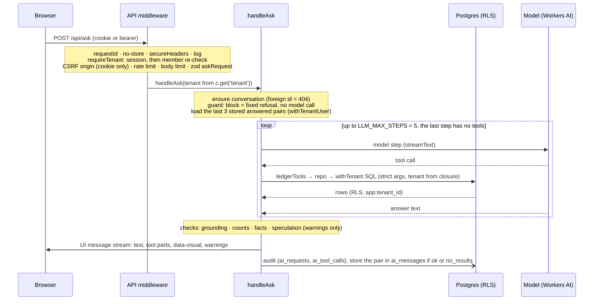

# /api/ask request path

Text twin of [`ask-request-path.svg`](ask-request-path.svg); change both together. Code: `apps/api/src/app.ts` (middleware order), `apps/api/src/orchestrator/index.ts` (`handleAsk`).

The stream starts with the first token, so text reaches the browser while the loop runs; audit and conversation writes happen when the stream ends. `present_visual` is a tool call inside the loop with no SQL: it re-shapes this request's recorded results (ADR 0009).
