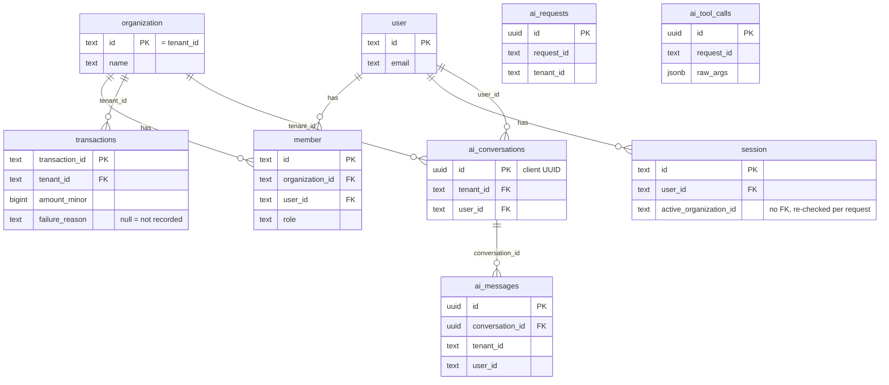

# Data model, roles and RLS

Text twin of [`data-model.svg`](data-model.svg); change both together. Source of truth: `packages/db/src/schema/` and `packages/db/src/roles.sql` (the generated table in `REPO_MAP.md` lists grants and RLS per table).

| Table | Role access | RLS |
|---|---|---|
| `transactions` | `ledger_reader`: SELECT only | FORCE, on `app.tenant_id` |
| `ai_conversations`, `ai_messages` | `ledger_app`: SELECT, INSERT | FORCE, on `app.tenant_id` and `app.user_id` |
| `ai_requests`, `ai_tool_calls` | `ledger_app`: INSERT only (no FKs; rows join on `request_id`) | none |
| Better Auth tables (`organization`, `user`, `member`, `session`, …) | `ledger_app`: full DML | none |

The owner role runs migrations and the seed, and bypasses RLS. The API never connects as it, and refuses to boot if either pool is a superuser or has BYPASSRLS.
