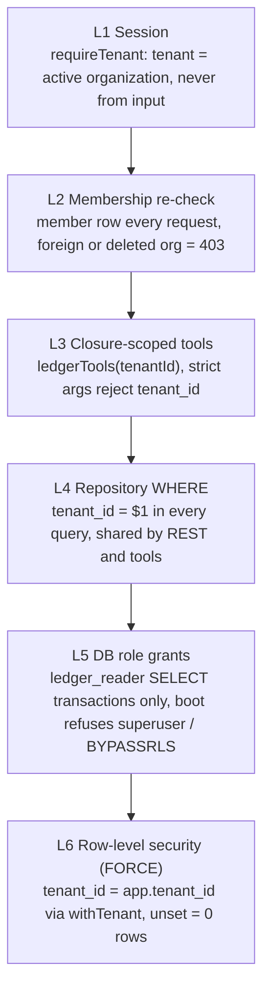

# Tenant boundary: six layers

Text twin of [`tenant-boundary-layers.svg`](tenant-boundary-layers.svg); change both together. Decisions: ADR 0004 (roles), ADR 0010 (RLS).

| Layer | If this layer has a bug |
|---|---|
| L1, L2 | The wrong tenant is chosen, and L3–L6 cannot detect it. These layers decide which tenant; the HTTP isolation tests cover them. |
| L3 | A tool that skips the closure still hits L4, which binds the tenant. |
| L4 | A query that omits the WHERE clause is still filtered by L6. |
| L5 | Grant drift fails `roles.test.ts` in CI; no write path exists to misuse. |
| L6 | The owner role bypasses RLS; it runs only migrations and the seed. |

Residual risk: a cross-tenant read needs a bug in the app layers (L3–L4) **and** in the database layers (L5–L6). The audit and Better Auth tables have no RLS (ADR 0010).
